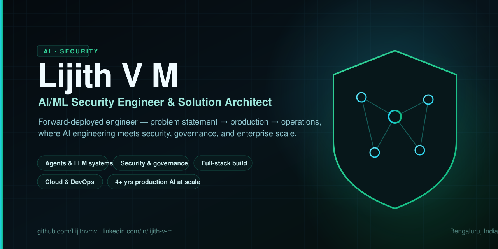

  

# Hi, I'm Lijith 👋

### Forward-Deployed Enterprise AI Engineer & Solution Architect · AI Research · AI Security & Governance · Bengaluru, India

> **Forward-deployed engineer:** I understand enterprise ecosystems, find the gaps and opportunities, architect the
> solution, and take it from problem discovery to production, aligned with enterprise security, engineering standards
> and operational requirements. Alongside the delivery work, I research how AI agents fail and how to make them safe,
> and I publish what I measure, weakest result first.

For **5+ years** I've built production AI solutions and enterprise applications at the intersection of **enterprise
AI, agentic engineering, application architecture and cybersecurity**.

My work goes beyond building a model or a single application. I start by understanding the enterprise as a whole:
its infrastructure, applications, technology stack, information architecture, security boundaries, engineering
practices, integrations and operational requirements. Then I find the gaps in existing systems and processes, turn
business and technical problems into architecture, and own the whole lifecycle: **problem discovery → ecosystem
assessment → solution architecture → application design → development → security → deployment → production
operations.**

I've designed and built enterprise AI initiatives across **GRC, cybersecurity, incident response, skill evaluation and
AI governance**, including an AI-native GRC platform, AI-driven incident response, an end-to-end AI governance
approach, and an information architecture for a security organisation. I also build the engineering ecosystem those
applications need: agentic development workflows, application maturity standards and production-readiness criteria,
so that software built with AI-assisted development still meets enterprise engineering, security and operational
requirements.

I take applications from a laptop to enterprise-hosted virtual machines and Kubernetes, with the networking,
identity, access control, secrets management, CI/CD, monitoring and operational controls that come with that.

My journey started in applied machine learning and computer vision, moved into production GenAI and multi-agent
systems, and now covers enterprise AI architecture, agentic development, AI security research and enterprise
technology transformation.

🎓 DeepLearning.AI Machine Learning Specialization · Microsoft Azure AI Engineer Associate (AI-102), 2024–2026

## 🧭 What I do: from enterprise understanding to production

**1. Enterprise ecosystem understanding & architecture**
- Understand existing technology landscapes, applications, infrastructure, information flows, security architecture
  and operational processes.
- Assess architectural gaps, technical debt, integration problems, security limits, and where automation and AI can
  help.
- Turn enterprise requirements into target architectures, solution blueprints, integration patterns and
  implementation plans.
- Design solutions that fit the existing enterprise systems instead of adding isolated technology.

**2. Enterprise application architecture & engineering**
- Architect and build complete applications: backend services, frontends, APIs, databases, asynchronous workers and
  integration layers.
- Design modular, scalable, maintainable and secure architectures in Python, FastAPI, React, TypeScript, PostgreSQL,
  Redis, SQLAlchemy and Celery.
- Set engineering standards, reusable components, configuration-driven architectures, testing strategies and
  deployment practices.

**3. Agentic AI & enterprise AI development**
- Design multi-agent architectures, orchestration workflows, knowledge graphs and AI-powered automation that work with
  enterprise applications, APIs, information sources and controlled tools.
- Design agentic development ecosystems that bring AI coding agents into enterprise software engineering.
- Put engineering controls around agent permissions, code generation, validation, testing, security, review and
  deployment.

**4. Application maturity & production readiness**
- Design maturity frameworks that separate experimental prototypes, local applications, AI-assisted or "vibe-coded"
  applications, engineered applications and production-mature enterprise systems.
- Define objective gates for architecture, code quality, testing, security, identity, infrastructure, observability,
  reliability, documentation and operational ownership.
- Keep development speed aligned with enterprise risk, security and operational requirements, without mistaking a
  working demo for an enterprise-ready application.

**5. Enterprise infrastructure & deployment**
- Design deployment architectures that fit enterprise infrastructure and security requirements, on virtual machines
  and Kubernetes.
- Containerisation, networking, ingress, service communication, RBAC, managed identities, secrets management, CI/CD,
  infrastructure as code and observability, across Azure and GCP with Docker, Kubernetes and Terraform.
- Own the move from local development to deployed, monitored and maintainable applications.

**6. AI security, cybersecurity & governance**
- Build security and governance into AI and application architectures from the design stage.
- Design AI governance covering lifecycle controls, risk assessment, evaluation, accountability, approval workflows
  and continuous monitoring, including promoting agents from shadow mode to autonomy on measured performance.
- Address prompt injection, agent permissions, tool-call policy, data isolation, non-human identities, guardrails and
  auditability.
- Build AI-powered cybersecurity and GRC solutions: incident response, security automation, evidence management and
  compliance workflows.

**7. Enterprise information architecture**
- Design how enterprise information is structured, connected, governed, accessed and consumed: information domains,
  relationships, ownership, integration patterns and knowledge foundations.
- Apply knowledge graphs, semantic retrieval, vector search and connected information models to enterprise problems.

## 🔬 AI research: how agents fail, and what holds

I research the security and reliability of AI agents, and I build and measure the defences myself. The rule I hold
my own work to: **every number says what kind of data it comes from, and the weakest result goes first.**

**What I study**
- **Judging an agent's action by its consequence.** An agent can't reliably tell instructions from data, so detection
  alone loses to a motivated attacker. I study a different question at the moment of action: what does this action
  carry, and where is it going? On replays of one developer's real Claude Code sessions, judging each action this way
  held **1.7%** of calls for approval, where "freeze the session once it reads something untrusted" held about
  **76%**. On attacks it had never seen, it started weak. ([GuardLayer](https://github.com/Lijithvmv/Guard-Layer#what-the-evidence-says))
- **The gap between stated scope and actual reach.** Agents are told their scope in prose ("this repository", "no
  internet") but act with the reach their environment gives them: stored credentials, connected tool servers, network
  paths. Public incidents in 2026 followed that gap. I'm working on measuring it from the machine an agent runs on.
- **Evaluation integrity.** In my own coding-agent evaluations, the agent could see the grader. Its generated tests
  imported the grader in 6 of 8 false failures, and hiding the grader removed the false passes. A score is only
  meaningful if the thing being judged can't touch the judge.
  ([Newton](https://github.com/Lijithvmv/newton))
- **Agents that start on their own.** When an event (a ticket, an alert, a pull request) starts the agent instead of a
  person, whoever can write the event can start the agent. This is a position I hold; I haven't measured it yet.
- **Making small local models useful.** Planning work into small verifiable steps and selecting exactly the right
  context took the same 7B model from 0/6 to 6/6 on cross-file tasks (two tasks, three runs each).
- **Honest reporting by AI assistants.** Tooling that makes an assistant's confident claim meet a check before it
  counts. ([LevelWith](https://github.com/Lijithvmv/LevelWith))

**How I work**
- Real-use replay before claims: measure the cost to normal work, not only attacks stopped.
- Held-out data checked for contamination. In one study, 28% of my "held-out" sessions turned out to be copies of
  sessions used in design.
- First contact with third-party benchmarks reported untuned (InjecAgent, ASB, Invaris AgentSec) even when the result
  is poor; results on data a rule was developed on are labelled as tuned.
- Every tool's source read for default telemetry before I install it.

## 🏗️ Selected enterprise initiatives

**Enterprise AI & security solutions**
- **AI-native GRC platform:** GRC automation on knowledge graphs, multi-agent workflows, evidence pipelines,
  deterministic validation and human approval gates ("AI writes the rules and the words; deterministic code computes
  the numbers").
- **AI-driven incident response:** a dynamic approach to incident investigation and response orchestration.
- **AI governance:** an end-to-end enterprise approach covering lifecycle management, risk, security, evaluation,
  accountability and monitoring.
- **Enterprise information architecture for security:** structuring security knowledge, its relationships and where
  AI can help.
- **AI-powered skill evaluation:** structured, AI-driven competency assessment and evaluation.

**Agentic development & engineering ecosystem**
- An agentic development approach that brings AI agents into enterprise engineering workflows, with controlled code
  generation, development standards, validation, testing, security review and engineering oversight.
- An application maturity framework separating experimental or vibe-coded solutions, local applications, engineered
  applications and production-mature enterprise applications, on the principle that working on a laptop doesn't
  qualify an application for enterprise production.

**Production AI engineering**
- **Multi-agent GenAI platform:** 30+ agents orchestrated in LangGraph with a runtime plugin architecture
  (configuration-driven workflows), typed shared state, custom reducers and parallel execution. Multi-tenant, with a
  JWT-driven security context and tenant isolation enforced before retrieval.
- **Retrieval at scale:** hybrid vector retrieval (HNSW) over **100K+ records** with metadata isolation and audit
  logging. Batching embedding generation cut **P95 latency from 36 s to 2 s and cost by ~96%**.

**Enterprise infrastructure engineering**
- Terraform-driven virtual desktop infrastructure with golden-image pipelines and a planned scale-out path to **300
  VMs / 1,500 sessions**.
- Cross-subscription private networking, RBAC, managed-identity hardening and cloud infrastructure design.

**Applied ML & computer vision**
- CNN document-image classification across 200+ component types.
- GAN-based multi-view 3D / CAD generation (hackathon winner).
- Regression models predicting engineering test outcomes at ~92% accuracy.

## 🚀 Open source

| Project | What it is |
|---------|------------|
| **[GuardLayer](https://github.com/Lijithvmv/Guard-Layer)** | A runtime security layer for AI agents that judges each action by what it would do and what it carries, not by recognising the attack: local work runs; data sent to a place only an outsider named, and irreversible actions an outsider chose, wait for a human. No model needed (milliseconds per decision). Weakest first: on benchmarks it had never seen it started weak (19% on InjecAgent, 1 of 24 on ASB), and an attacker who knows its rules can get past it. In replay it held 1.7% of one developer's real Claude Code calls and 0.54% of another agent's work with no setup; on 707 recorded frontier-model attacks its rules were developed on, it held 76% of harmful calls with detectors off. Beta; [evidence and limits](https://github.com/Lijithvmv/Guard-Layer#what-the-evidence-says). |
| **[SOC-Graph-Guard](https://github.com/Lijithvmv/SOC-Graph-Guard)** | A security-first agentic SOC on LangGraph: verdicts computed from evidence (never from attacker-written text), graded autonomy, human approval before irreversible actions, injection screening and a tamper-evident audit. On 16 attack scenarios I wrote (two modelled on published incidents): guarded graph 12/16 fully correct with 0 unsafe actions, vs a naive agent's 5/16 with 24 unsafe actions. |
| **[Newton](https://github.com/Lijithvmv/newton)** | A fully local, offline coding agent that makes a small on-device model useful by planning work into verifiable steps and engineering its context. Took the same 7B model from 0/6 to 6/6 on cross-file tasks (two tasks, three runs each). |
| **[SkillProof](https://github.com/Lijithvmv/SkillProof)** | Deterministic, evidence-backed analysis of AI agent skill packages: structure, instruction quality, static security triage, paired with/without-skill evaluation, and an approval workflow with reviewer separation. Its benchmark is a three-task candidate; human-scored results aren't in yet. |
| **[LevelWith](https://github.com/Lijithvmv/LevelWith)** | Discipline aids so an AI assistant's confident report has to meet a check before it counts: a git push gate, a claims linter and an opt-in Claude Code Stop hook. A discipline aid, not a guarantee. |
| **[Sequel](https://github.com/Lijithvmv/Sequel)** | A natural-language-to-SQL assistant with a validation stage and a deterministic read-only guard. A prototype: SQL accuracy is not yet evaluated. |
| **[Enterprise-AI-OS](https://github.com/Lijithvmv/Enterprise-AI-OS)** | A curated map for building, running and controlling enterprise AI, with each entry's mechanism and a telemetry warning where a tool sends data by default. |

## ⚙️ Technology & engineering

- **Agentic AI & AI security:** Python, LangGraph, LangChain, multi-agent systems, agent orchestration, MCP, guardrails,
  prompt-injection defence, tool-call and egress policy, agent evaluation, red-teaming, LLM evaluation.
- **Knowledge & information architecture:** knowledge graphs, GraphRAG, hybrid search, vector databases, embeddings,
  reranking, pgvector, FAISS, BM25.
- **Application engineering:** FastAPI, React, TypeScript, PostgreSQL, SQLAlchemy, Alembic, Celery, Redis, REST APIs,
  microservices.
- **Agentic development:** AI coding agents, agentic workflows, code generation, engineering automation, testing and
  evaluation, development governance.
- **Infrastructure & deployment:** Docker, Kubernetes, Azure, GCP, Terraform, CI/CD, virtual machines, networking,
  ingress, managed identities, observability.
- **Security & governance:** AI governance, AI risk management, RBAC, identity and non-human identity, ISO 27001,
  PCI DSS, DPDP.
- **Local & applied ML:** Ollama and small local models, PyTorch, TensorFlow, CNNs, GANs.

## 🧱 My engineering philosophy

Enterprise AI isn't just building an intelligent application. It's understanding the ecosystem that application has
to live in.

Understand the enterprise. Find the gaps. Architect the solution. Engineer the application. Build in security and
governance. Deploy into the enterprise infrastructure. Establish production maturity. Own it end to end.

A working prototype isn't a production system, and a deployed application isn't automatically enterprise-ready. The
architecture, security, reliability, governance and operational discipline behind it decide its maturity. The same
goes for claims: a result isn't real until it's measured, labelled and shown with its weakest number first. That's
the standard I engineer towards.

## 📊 GitHub

